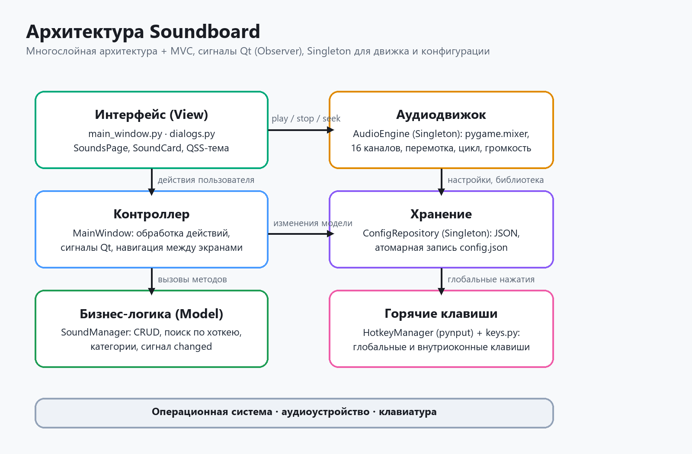
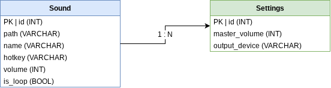
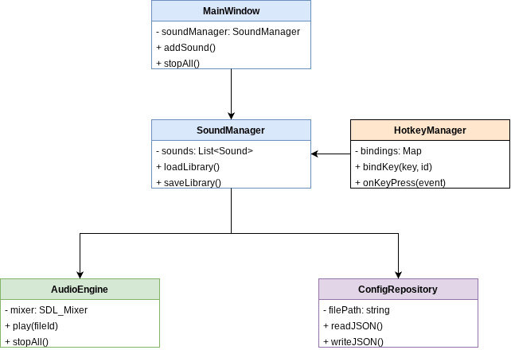

Архитектура приложения
=======================

Общая схема
-----------

Приложение построено по многослойной архитектуре с элементами MVC:

* **View (интерфейс)** — модули ``main_window.py``, ``dialogs.py``, ``theme.py``;
* **Controller** — класс ``MainWindow``: принимает действия пользователя,
  вызывает бизнес-логику и обновляет интерфейс;
* **Model (бизнес-логика)** — ``SoundManager``: библиотека звуков, категории,
  поиск по горячей клавише, сохранение;
* **Audio Engine** — ``AudioEngine`` (Singleton) на ``pygame.mixer``:
  каналы, перемотка, зацикливание, громкость, сигналы о состоянии;
* **Storage** — ``ConfigRepository`` (Singleton): загрузка и атомарное
  сохранение JSON;
* **Hotkeys** — ``HotkeyManager`` (pynput) и ``keys.py``: глобальные
  и внутриоконные горячие клавиши.

Взаимодействие слоёв
--------------------

Обновление интерфейса построено на сигналах Qt (паттерн **Observer**):

* ``AudioEngine.started`` / ``finished`` / ``progress`` / ``error`` —
  начало, завершение, позиция и ошибки воспроизведения;
* ``SoundManager.changed`` — изменение библиотеки;
* ``SoundsPage`` передаёт наверх сигналы действий: клик по карточке,
  перемотка, переключение цикла, изменение громкости, контекстное меню.

Контроллер ``MainWindow`` связывает эти сигналы с методами модели и движка.
Благодаря этому интерфейс не работает со звуком напрямую, а движок не знает
о виджетах.

Используемые паттерны
---------------------

.. list-table::
   :widths: 20 80
   :header-rows: 1

   * - Паттерн
     - Где применяется
   * - MVC
     - разделение интерфейса (``main_window``), модели (``SoundManager``)
       и управления (``MainWindow``)
   * - Singleton
     - ``AudioEngine`` и ``ConfigRepository`` — единственные экземпляры
       на всё приложение
   * - Observer
     - сигналы и слоты Qt для обновления UI и реакции на события звука
   * - Repository
     - ``ConfigRepository`` скрывает детали хранения JSON
   * - Dataclass
     - модель ``Sound`` с методами сериализации ``to_dict``/``from_dict``

Структура модулей
-----------------

.. list-table::
   :widths: 24 76
   :header-rows: 1

   * - Модуль
     - Ответственность
   * - ``main.py``
     - точка входа: QApplication, палитра, тёмная тема, иконка, главное окно
   * - ``main_window.py``
     - интерфейс: ``SoundsPage``, ``SoundCard``, ``CardScrollArea``,
       диалоги, навигация, обработка действий
   * - ``audio_engine.py``
     - воспроизведение и миксирование, перемотка вырезанием PCM,
       зацикливание без перезапуска, громкость, сигналы
   * - ``sound_manager.py``
     - CRUD библиотеки, поиск по клавише, категории, автоназначение клавиш
   * - ``config_repository.py``
     - загрузка/сохранение JSON, атомарная запись через временный файл
   * - ``models.py``
     - модель ``Sound`` и сериализация
   * - ``dialogs.py``
     - добавление звука, назначение клавиши, настройки, список клавиш
   * - ``hotkey_manager.py``
     - глобальный перехват клавиш через pynput
   * - ``keys.py``
     - приведение клавиш Qt/pynput к единому виду, русская раскладка
   * - ``theme.py``
     - палитра и QSS-стили тёмной темы

Модель данных
-------------

В MVP реляционная база не используется: библиотека и настройки хранятся
в JSON. Концептуальная ER-модель показывает, как проект можно перевести
на SQLite при развитии.

Основные сущности:

* **Sound** — ``id``, ``name``, ``path``, ``hotkey``, ``volume``,
  ``is_loop``, ``category``;
* **Settings** — ``master_volume``, ``allow_overlap``, ``loop_all``,
  ``remember_settings``, ``global_hotkeys``.

Связь — одна конфигурация содержит множество звуков (1:N).

Диаграмма классов
-----------------

Поток данных при запуске звука
------------------------------

1. Пользователь нажимает клавишу или кликает по карточке.
2. ``MainWindow`` проверяет, играет ли уже звук, и вызывает
   ``AudioEngine.play`` или ``stop``.
3. ``AudioEngine`` загружает звук (кэш), выделяет канал, применяет
   громкость и режим цикла, запускает воспроизведение.
4. Движок испускает сигналы ``started`` и ``progress``; интерфейс
   подсвечивает карточку и обновляет полосу перемотки.
5. По завершении или остановке приходит сигнал ``finished``;
   карточка возвращается в исходное состояние, запись исчезает
   из панели «Сейчас играет».

Хранение и восстановление
-------------------------

Файл конфигурации создаётся в ``~/.config/soundboard/config.json``
(в Windows — ``C:\Users\<пользователь>\.config\soundboard\config.json``).
Запись выполняется через временный файл и ``Path.replace``, чтобы
не повредить данные при сбое. При отсутствии файла приложение стартует
с пустой библиотекой и настройками по умолчанию.
