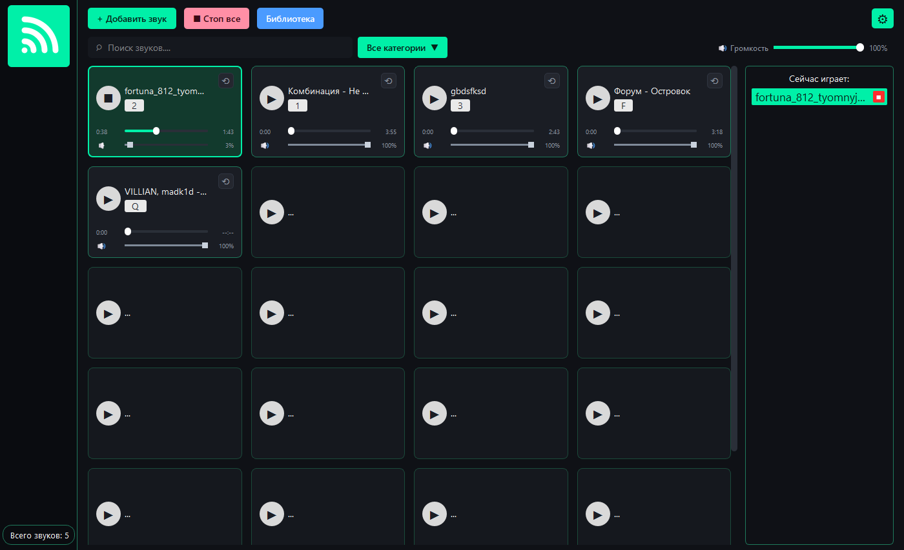
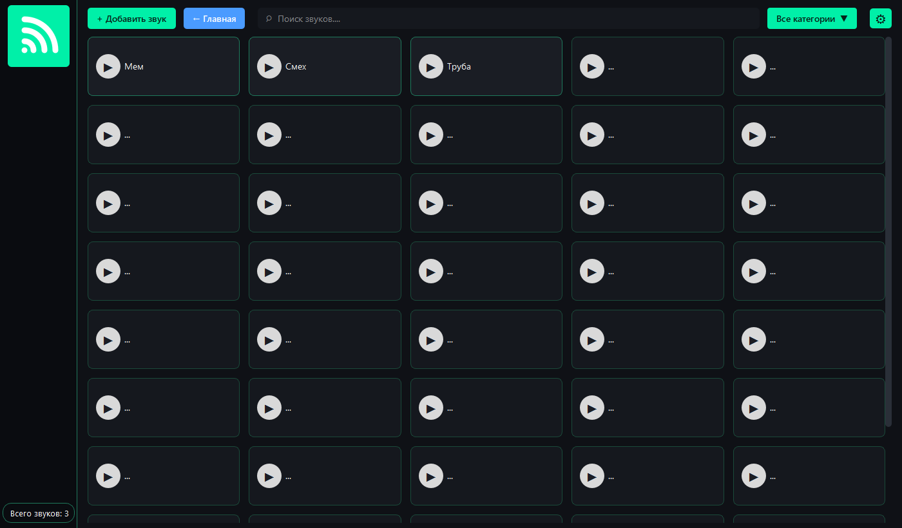
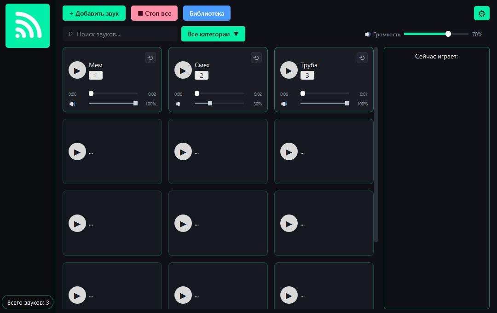

Функциональность
================

Главный экран
-------------

Главный экран представляет собой сетку карточек звуков. Число колонок
зависит от ширины окна: 3 колонки на узком экране, 4 — на широком.
Сетка продолжается вниз, поэтому колесо мыши прокручивает список,
даже если звуков немного.

На каждой карточке:

* название звука и назначенная клавиша;
* кнопка запуска/остановки;
* полоса перемотки с текущим и полным временем;
* кнопка зацикливания ⟲;
* регулятор громкости звука;
* контекстное меню по правой кнопке.

В верхней панели расположены «Добавить звук», «Стоп все», «Библиотека»,
поиск, фильтр категорий, общая громкость и кнопка настроек.

Воспроизведение
---------------

* запуск и остановка кликом по карточке;
* запуск по горячей клавише (в окне и глобально);
* одновременное воспроизведение до 16 звуков;
* мгновенная остановка всех звуков кнопкой «Стоп все» или клавишей Esc;
* подсветка активной карточки и панель «Сейчас играет».

Перемотка
---------

Полоса перемотки позволяет:

* перемотать звук кликом в нужное место;
* перетащить ползунок во время воспроизведения;
* начать воспроизведение с выбранной позиции, если звук ещё не играет.

Перемотка реализована без внешних библиотек: из PCM-данных звука
вырезается фрагмент с нужного смещения, который проигрывается как
самостоятельный звук. Поэтому перемотка работает и для MP3, и для WAV/OGG.

Зацикливание
------------

Кнопка ⟲ включает повтор. Важные особенности:

* включение цикла во время воспроизведения не перезапускает звук
  и не сдвигает позицию;
* трек доигрывает до конца и начинается сначала — без «прыжка назад»
  к месту включения;
* цикл, включённый заранее, сразу играет бесшовно с начала;
* выключение цикла даёт текущему проходу доиграть и останавливает звук
  в конце.

Громкость
---------

* громкость каждой карточки — отдельный регулятор (0–100 %);
* общая громкость — в верхней панели, синхронизирована с настройками;
* изменения сохраняются в JSON; громкость применяется сразу.

Библиотека
----------

Экран «Библиотека» открывается кнопкой в верхней панели. Здесь карточки
показаны без регуляторов — экран предназначен для управления коллекцией:
поиск, фильтр категорий, добавление и удаление звуков. Число колонок
адаптируется под ширину окна (3–5).

Поиск и категории
-----------------

* поиск фильтрует карточки по названию в реальном времени;
* категории задаются при добавлении звука;
* фильтр «Все категории» показывает только выбранную категорию.

Горячие клавиши
---------------

.. list-table:: Управление с клавиатуры
   :widths: 30 70
   :header-rows: 1

   * - Клавиша
     - Действие
   * - назначенные пользователем
     - запуск/остановка соответствующего звука
   * - ``Esc``
     - остановить все звуки (режим паники)
   * - ``Backspace`` / ``Delete``
     - очистить клавишу в диалоге назначения

Глобальные клавиши работают, когда окно программы неактивно, если включён
соответствующий флажок в настройках и установлен ``pynput``. Перехват
работает при неактивном окне программы.

Форматы и ограничения
---------------------

* поддерживаемые форматы: WAV, OGG, MP3;
* число одновременно воспроизводимых звуков — до 16;
* задержка запуска — не более 100 мс;
* рекомендуемая библиотека — от 20 звуков без деградации;
* хранение — локальный JSON, без сети и персональных данных.

