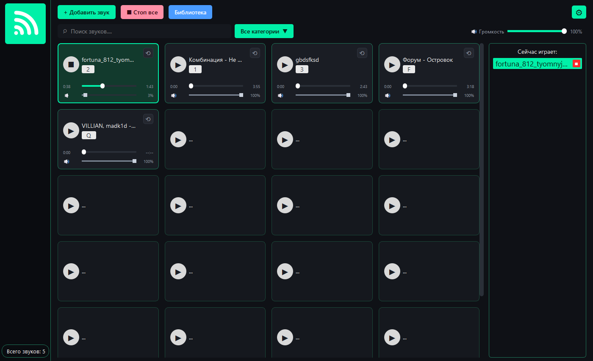

Soundboard — пульт звуковых эффектов
=====================================

**Soundboard** — десктопное приложение для Windows для быстрого
воспроизведения звуковых сэмплов, фоновой музыки и звуковых эффектов
по горячим клавишам. Используется ведущими мероприятий, подкастерами,
звукорежиссёрами учебных театров и студентами на демонстрациях.

Документация подготовлена в рамках учебной практики (дни 15–18):
здесь описаны архитектура, функциональность, руководства пользователя
и разработчика, API и процесс поддержки проекта.

Возможности
-----------

* сетка звуковых карточек с подсветкой активных;
* добавление WAV, OGG и MP3, категории и поиск;
* горячие клавиши, в том числе глобальные (когда окно неактивно);
* перемотка внутри звука, зацикливание и громкость каждой карточки;
* общая громкость и кнопка «Стоп все», режим паники по клавише Esc;
* сохранение библиотеки и настроек в JSON между запусками;
* тёмная тема, адаптивная сетка (3–5 колонок);
* готовая Windows-сборка (``Soundboard.exe`` и папка ``_internal``).

.. list-table:: Кратко о проекте
   :widths: 30 70

   * - Назначение
     - пульт звуковых эффектов для сцены, подкастов и учебных демонстраций
   * - Технологии
     - Python 3.12, PyQt6, pygame.mixer, pynput, JSON, PyInstaller, Sphinx
   * - Платформы
     - Windows 10/11 (64 бит)
   * - Хранение данных
     - ``~/.config/soundboard/config.json``
   * - Автор
     - Загайнов Никита Александрович, группа ИСП-341
   * - Руководитель
     - Николаенко Владимир Владимирович

.. toctree::
   :maxdepth: 2
   :caption: Документация

   architecture
   functionality
   user_manual
   developer_manual
   examples
   api
   support
   changelog

.. note::

   Исходный код, готовые сборки и инструкции по установке находятся
   в папке проекта. Быстрый запуск описан в разделе
   :doc:`user_manual`, сборка — в :doc:`developer_manual`.

Индексы и поиск
---------------

* :ref:`genindex`
* :ref:`modindex`
* :ref:`search`
