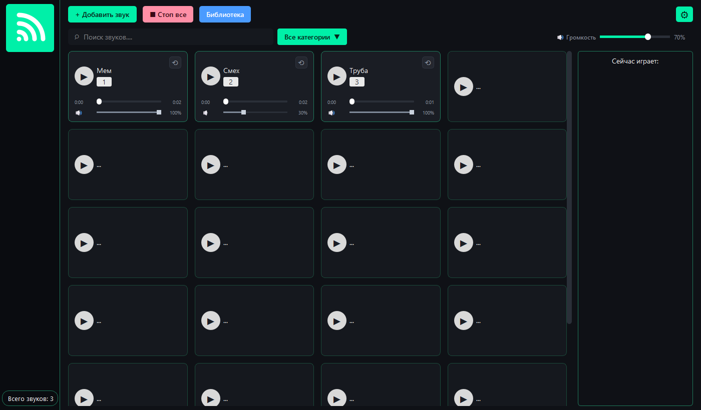
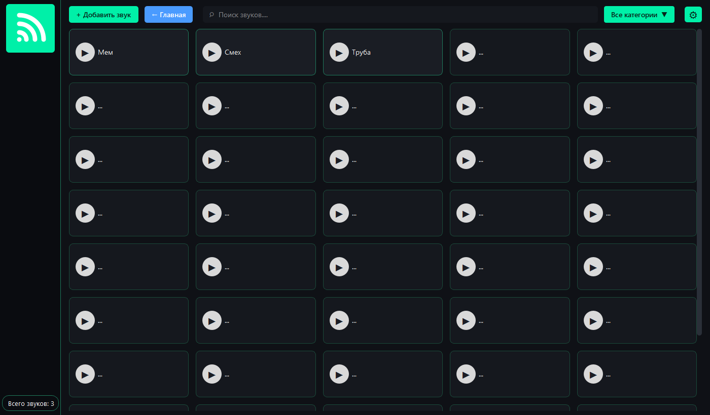

Руководство пользователя
========================

Назначение программы
--------------------

«Soundboard» — простая звуковая панель для мгновенного запуска музыки
и звуковых эффектов по горячим клавишам. Программа предназначена для
ведущих мероприятий, подкастеров, звукорежиссёров учебных театров
и студентов, которым нужно управлять звуком во время выступления.

Программа работает локально на Windows, не требует интернета и регистрации.

   Главный экран: карточки звуков, «Сейчас играет», общая громкость

Условия выполнения
------------------

Технические требования:

* компьютер или ноутбук с аудиовыходом и клавиатурой;
* не менее 2 ГБ оперативной памяти;
* около 200 МБ свободного места на диске;
* Windows 10 или Windows 11 (64 бит).

Программные требования:

* достаточно папки ``dist\Soundboard`` с файлом ``Soundboard.exe``;
  Python и библиотеки устанавливать не требуется;
* для запуска из исходного кода — Python 3.10+ и зависимости из
  ``requirements.txt`` (см. :doc:`developer_manual`).

Запуск программы
----------------

* дважды щёлкните ярлык **Soundboard** на рабочем столе;
* либо откройте папку ``dist\Soundboard`` и запустите ``Soundboard.exe``
  (рядом должна находиться папка ``_internal``).

При первом запуске открывается главное окно с пустыми карточками —
добавьте звуки кнопкой «+ Добавить звук».

Добавление звука
----------------

#. Нажмите **«+ Добавить звук»**.
#. Выберите файл кнопкой «Выбрать файл» или перетащите его в область выбора.
#. Укажите название (по умолчанию подставляется имя файла).
#. При необходимости выберите категорию и назначьте горячую клавишу.
#. Нажмите **«Добавить»** — звук появится на свободной карточке.

Поддерживаются форматы WAV, OGG и MP3. Файлы не копируются в папку
программы: сохраняется путь к исходному файлу. Если файл переместить
или удалить, при запуске появится сообщение об ошибке.

Запуск и остановка
------------------

* **Запуск:** щёлкните по карточке или нажмите назначенную клавишу.
* **Остановка:** повторный клик по карточке, кнопка «■» в панели
  «Сейчас играет» или кнопка **«Стоп все»**.
* **Паника:** клавиша ``Esc`` мгновенно останавливает все звуки.
* Во время воспроизведения карточка подсвечивается, а в панели
  «Сейчас играет» появляется название звука.

Можно запускать несколько звуков одновременно (например, фон и эффект).

Перемотка, зацикливание и громкость
-----------------------------------

На каждой карточке главного экрана есть встроенные регуляторы:

* **перемотка** — потяните ползунок или щёлкните в нужном месте полосы;
  время показывается слева и справа от полосы;
* **зацикливание** — кнопка ⟲. Включение во время воспроизведения
  не перезапускает звук; трек доигрывает и начинается сначала.
  Выключение даёт текущему проходу доиграть и останавливает звук;
* **громкость звука** — ползунок с динамиком (0–100 %);
* **общая громкость** — ползунок в верхней панели, применяется ко всем
  звукам и сохраняется в настройках.

Если звук остановлен, перемотка запоминает позицию, и следующее
воспроизведение начнётся с неё.

Библиотека
----------

Кнопка **«Библиотека»** открывает экран управления коллекцией:

* карточки без регуляторов — удобно для просмотра и удаления;
* поиск по названию;
* фильтр по категориям;
* число колонок адаптируется под ширину окна;
* логотип в левом верхнем углу возвращает на главный экран.

   Экран «Библиотека»

Горячие клавиши
---------------

* назначенные клавиши запускают и останавливают соответствующие звуки;
* ``Esc`` — остановить все звуки;
* в диалоге назначения ``Backspace``/``Delete`` очищают клавишу.

Чтобы перехват работал, когда окно программы неактивно, включите
в настройках флажок **«Горячие клавиши работают, когда окно не в фокусе»**.
Для этого нужна библиотека ``pynput``.

Настройки
---------

Окно **«Настройки»** (кнопка ⚙) позволяет:

* изменить общую громкость;
* разрешить или запретить одновременное воспроизведение;
* включить зацикливание всех звуков;
* запоминать настройки между запусками;
* включить глобальные горячие клавиши;
* открыть список звуков и назначить клавиши.

Изменения применяются сразу после нажатия «Сохранить».

Сохранение данных
-----------------

Библиотека и настройки сохраняются автоматически при каждом изменении
в файл ``%APPDATA%\Soundboard\config.json``
(обычно ``C:\Users\<пользователь>\AppData\Roaming\Soundboard\config.json``).

Отдельная команда «Сохранить» не требуется. Для резервной копии достаточно
скопировать этот файл; для переноса библиотеки на другой компьютер —
скопировать файл и проверить пути к аудиофайлам.

Сообщения и действия
--------------------

.. list-table::
   :widths: 45 55
   :header-rows: 1

   * - Сообщение
     - Что делать
   * - «Выберите аудиофайл (WAV, OGG или MP3).»
     - выбрать файл в диалоге добавления
   * - «Введите название звука.»
     - заполнить поле названия
   * - «Клавиша занята»
     - назначить другую клавишу или изменить клавишу у существующего звука
   * - «Не удалось загрузить «…»: …»
     - проверить, что файл существует и не повреждён; добавить заново
   * - «Нет свободных аудиоканалов»
     - остановить часть звуков кнопкой «Стоп все»
   * - «Не удалось запустить аудиодвижок: …»
     - проверить аудиоустройство и драйверы, перезапустить программу
   * - «Глобальные клавиши недоступны (не установлен pynput)»
     - установить ``pynput`` или работать в окне программы

Частые проблемы
---------------

**Нет звука.** Проверьте устройство вывода в Windows и общую громкость
приложения. Если аудиоустройство занято или отсутствует, при запуске
появится предупреждение.

**Файл не найден.** Аудиофайл был перемещён или удалён. Добавьте его
в библиотеку заново.

**Не работают глобальные клавиши.** Убедитесь, что флажок включён и
установлен ``pynput``; при необходимости запустите программу от имени
пользователя с обычными правами.

**Windows Defender блокирует exe.** Файл собран локально и не подписан;
добавьте папку ``dist\Soundboard`` в исключения.

Завершение работы
-----------------

Закройте окно программы. Библиотека и настройки сохраняются автоматически.
