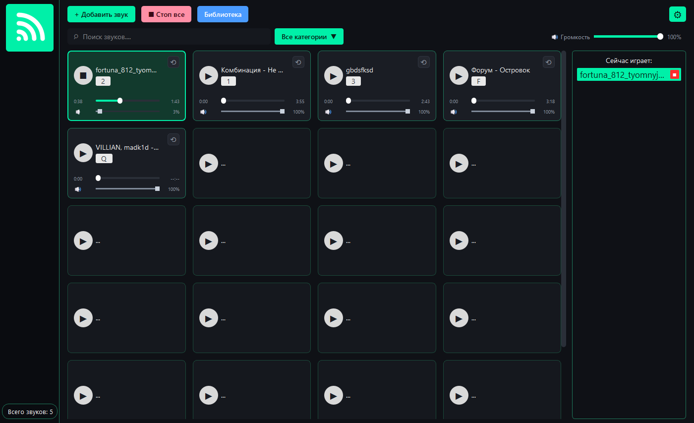

# Soundboard — пульт звуковых эффектов (Windows)

Десктопное приложение для Windows, которое мгновенно воспроизводит звуковые
эффекты и фоновую музыку по горячим клавишам. Используется ведущими
мероприятий, подкастерами, звукорежиссёрами учебных театров и студентами
на демонстрациях.



## Возможности

- сетка звуковых карточек с подсветкой активных;
- добавление WAV, OGG, MP3, категории и поиск;
- горячие клавиши, включая глобальные (когда окно неактивно);
- перемотка внутри звука, зацикливание и громкость каждой карточки;
- общая громкость и кнопка «Стоп все», режим паники по `Esc`;
- экран «Библиотека» для управления коллекцией;
- тёмная тема, адаптивная сетка (3–5 колонок);
- сохранение библиотеки и настроек в JSON;
- готовая Windows-сборка (`Soundboard.exe`).

## Быстрый запуск

Готовая сборка: `dist\Soundboard\Soundboard.exe` (рядом должна лежать папка
`_internal`). Запускается двойным кликом; Python устанавливать не нужно.

Запуск из исходного кода:

```powershell
cd C:\Users\<user>\Desktop\soundboard
.\.venv\Scripts\python.exe Код\main.py
```

## Сборка

```bat
build_exe.bat
```

Результат: `dist\Soundboard\Soundboard.exe` вместе с `_internal`.
Сборка выполняется в режиме onedir — приложение не распаковывается
во временную папку при каждом запуске.

## Документация

- собранная HTML-документация: `..\Документация\HTML\index.html`
- исходники Sphinx: `..\Документация\Sphinx\`
- презентация: `..\Документация\Презентация\`
- отчёт с приложениями: `..\Документация\Отчёт\`

Сборка документации:

```bat
cd ..\Документация\Sphinx
build_docs.bat
```

## Тесты

```powershell
cd Код
..\.venv\Scripts\python.exe -m unittest discover -s tests -v
```

Тесты проверяют модель, конфигурацию, библиотеку звуков, клавиши и
аудиодвижок на dummy-драйвере SDL.

## Структура

```
soundboard/
├── .venv/                  # виртуальное окружение
├── Код/                    # исходный код и сборка
│   ├── main.py
│   ├── main_window.py
│   ├── audio_engine.py
│   ├── sound_manager.py
│   ├── config_repository.py
│   ├── models.py
│   ├── dialogs.py
│   ├── hotkey_manager.py
│   ├── keys.py
│   ├── theme.py
│   ├── assets/
│   ├── tests/
│   ├── dist/Soundboard/    # готовая Windows-сборка
│   ├── build_exe.bat
│   ├── requirements.txt
│   ├── README.md
│   └── BACKLOG.md
└── Документация/
    ├── HTML/               # собранная Sphinx-документация
    ├── Sphinx/             # исходники документации
    ├── Презентация/        # pptx и pdf
    └── Отчёт/              # отчёт и приложения
```

## Поддержка

- бэклог: `BACKLOG.md`;
- известные ограничения: `..\Документация\HTML\support.html`;
- шаблоны ошибок и предложений: `.github\ISSUE_TEMPLATE\`.

## Автор

Загайнов Никита Александрович, группа ИСП-341, 2026 г.
Руководитель: Николаенко Владимир Владимирович.
